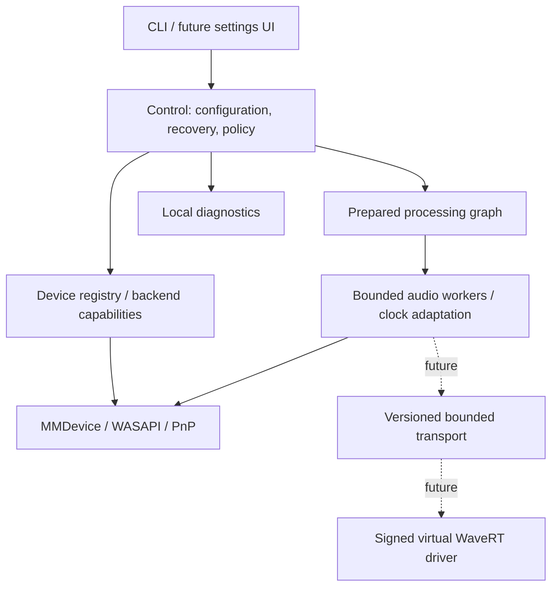

# Architecture
Research baseline: 2026-10-18. "Verified" below means documented API capability;
actual local tests are in [VALIDATION.md](VALIDATION.md).

## Components and ownership

C++20 and CMake, Windows 11 x64 initially. No third-party runtime dependencies.
The portable library owns formats and the clock-adapting bridge. The Windows
library owns COM, MMDevice, event handles and WASAPI. The CLI owns controls and
output. Concrete, narrow interfaces precede a speculative plugin framework.

The prototype has one audio worker owning both streams and the entire bridge.
Statistics use lock-free atomics; no sample queue crosses threads. All clients,
buffers and coefficients are prepared before MMCSS registration. The processing
loop does not allocate, log, throw, acquire mutexes or perform file I/O. Waiting
for audio/cancel events is necessary scheduling, not a producer lock. Resources
are stopped/released on their owning thread after leaving MMCSS priority.

## HAL and device registry
Device snapshots expose opaque ID, direction, state, friendly name, default roles,
shared mix layout and available engine periods. Enumerate eAll with
DEVICE_STATEMASK_ALL, preserving inactive endpoints and per-device failures.
This covers endpoints exposed by MMDevice, not every USB/PnP object or ASIO-only
device.

Verified: GetMixFormat reports the shared engine format, not all hardware formats.
IsFormatSupported tests specific format/mode tuples; there is no universal
exhaustive WASAPI format list. Later capability probes must report exact format,
mode, HRESULT and closest match without implying completeness.
[Mix format](https://learn.microsoft.com/en-us/windows/win32/api/audioclient/nf-audioclient-iaudioclient-getmixformat),
[format probes](https://learn.microsoft.com/en-us/windows/win32/api/audioclient/nf-audioclient-iaudioclient-isformatsupported).

Future persistence stores endpoint IDs plus container/PnP instance/transport hints
and user aliases. IDs can change with ports, profiles and reinstallations.
Friendly names are not identities; ambiguous replacements require user selection.
Configuration needs a versioned schema, atomic replacement and migration tests.

IMMNotificationClient callbacks only increment an atomic generation. The control
thread re-enumerates and reports differences; bursts may coalesce. Callbacks do
not block, unregister or release final MMDevice references.
[Callback contract](https://learn.microsoft.com/en-us/windows/win32/api/mmdeviceapi/nn-mmdeviceapi-immnotificationclient).

## First routing engine
For `route`, source and destination are render endpoints. Capture the source's
shared mix with EVENTCALLBACK | LOOPBACK; its original playback continues.
For `monitor`, the source is a capture endpoint initialized with EVENTCALLBACK
without LOOPBACK. Both render to the destination's own mix format. Resolve defaults
once, pin canonical IDs, validate endpoint direction in both CLI and engine, and
reject identical IDs. Microphone access remains subject to OS privacy policy.
[Input capture](https://learn.microsoft.com/en-us/windows/win32/coreaudio/capturing-a-stream),
[stream initialization](https://learn.microsoft.com/en-us/windows/win32/api/audioclient/nf-audioclient-iaudioclient-initialize).

Try the minimum advertised IAudioClient3 render period, then fall back using a
fresh IAudioClient. Loopback uses ordinary shared Initialize: IAudioClient3 lists
only EVENTCALLBACK as its supported stream flag. Report actual negotiated buffers
and periods; they are not measured end-to-end latency.
[Loopback](https://learn.microsoft.com/en-us/windows/win32/coreaudio/loopback-recording),
[IAudioClient3](https://learn.microsoft.com/en-us/windows/win32/api/audioclient/nf-audioclient-iaudioclient3-initializesharedaudiostream).

Initial formats: float32 or PCM16/24/32, 8--192 kHz, 1--8 channels,
source/destination rate ratio 0.5--2. Unknown multichannel maps are rejected.
Legacy mono/stereo masks can be inferred. A prepared channel map selects one input
channel per output, including duplication or explicit silence. An omitted map
requires matching layouts; no downmix or upmix is guessed. Mapping occurs after
decode and before SRC, whose internal width matches the destination. All scratch
buffers are allocated before stream start. Gain matrices remain a later node.
Decode/encode PCM without alignment or aliasing assumptions;
validate container/valid bits and sanitize nonfinite samples.

A bounded ring feeds a 64-tap Blackman-windowed sinc converter with interpolated
512-phase tables prepared off-thread. A transition band reserves anti-alias margin.
Destination consumption defines the schedule. Smoothed occupancy PI correction
adjusts the nominal rate ratio within +/-2000 ppm, slewed at 200 ppm/s. It handles
modest drift; this is not hardware clock synchronization or a mastering-quality
SRC certification. Quantitative passband, alias and long-run tests gate improvement.

The target queue is at least the requested duration and two capture buffer sizes.
Report the actual queue and buffers; a 30 ms request may require more buffering.
Underflow produces silence and reprimes. Overflow/discontinuity clears stale state
and reprimes. Counters expose silence, underruns, overflows, discontinuities and
timestamp errors. A silent source may stop loopback packets; those counters alone
cannot diagnose a hardware dropout.

## Recovery
State machine: opening -> running -> waiting/retrying -> opening, or stopped/failed.
Invalidation, resources loss, missing devices, exclusive contention and unavailable
audio service release resources and retry with 0.5--4 second backoff. A render event
watchdog detects stalls. Input capture also has a packet watchdog; idle loopback
is exempt because the OS may stop supplying packets. Explicit destinations never
follow new default devices.
Unsupported formats and unsafe routes terminate with meaningful errors. The worker
observes a cancellation event during event waits and recovery. Actual USB replug,
sleep/resume and service restart are required hardware tests.
[Invalidation](https://learn.microsoft.com/en-us/windows/win32/coreaudio/recovering-from-an-invalid-device-error).

## Long-term graph and client protocol
Backends expose prepare/start/stop, capture/render blocks, capability negotiation
and QPC-correlated clock positions. Each unsynchronized device is a clock domain.
Use IAudioClock/timestamps to estimate drift and measured transport latency;
occupancy remains a buffer-safety input. Timestamp-error flags invalidate estimates.

Compile graph changes on the control plane into immutable schedules, swap at block
boundaries and retire memory off-thread. Add preallocated SPSC client transports,
sequence numbers and explicit buffer ownership when more threads/clients are needed.
Graph cycles require an explicit delay. Hardware/acoustic or cross-process loops
cannot be inferred reliably.

Built-ins: gain, channel matrices, sample conversion, resampling and metering.
Node contracts specify maximum block size, sample layout, timestamp semantics,
latency, tails and resets. Host untrusted plugins in isolated processes with bounded
transport and silence/bypass policies. Never put effects in kernel. Exclusive
WASAPI is a future mode; it cannot serve as shared loopback. Multiple clients
cannot independently own one exclusive hardware stream.

## Genuine virtual endpoints: next major target
Investigate a minimal WDM/PortCls WaveRT miniport, using SysVAD as an architectural
reference. SysVAD demonstrates virtual hardware; it is not a complete cable.
Implement render/capture pins, format tables, cyclic buffers, clock/position
reporting, PnP/power, timing and a bounded user-engine transport. Omit sample
offload, keyword detection and APO features unless required.
[SysVAD](https://learn.microsoft.com/en-us/windows-hardware/drivers/audio/sample-audio-drivers).

Keep kernel responsibilities to safe endpoint transport/timing. If the engine dies,
capture produces silence and unconsumed render data is bounded/discarded. Validate
every IOCTL length, offset and channel count; enforce access control, per-session
authorization, quotas and overflow-safe arithmetic. No trusted user pointers.
Review IRQL, cancellation, rundown, process death and shared-memory ownership.

Acceptance requires static analysis, fuzzing, dedicated-system Driver Verifier/HLK,
Secure Boot/memory-integrity compatibility and supported signing. Installation and
removal need elevation; normal use should not. Never disable signature enforcement
or weaken Windows protections. Signing infrastructure is a release dependency.
[Signing requirements](https://learn.microsoft.com/en-us/windows-hardware/drivers/dashboard/code-signing-reqs).

## Aggregation and multi-output
A virtual endpoint presents stable channel slots; the engine opens physical members.
Save channel assignments, nominal rate, master clock, per-member adaptive resampling
and measured delay. Missing members preserve slots with silence/drop output.
Master loss follows an explicit restart/failover policy. Drift correction does not
guarantee phase alignment of speakers; calibration and hardware sync matter.

Engineering hypothesis: our future driver plus these clock adapters can expose a
reliable multi-client aggregate. This is unimplemented. Test actual Windows shared
multichannel limits, including restrictions on arbitrary >8-channel UAC2 formats.
[Apple drift guidance](https://support.apple.com/en-gw/guide/audio-midi-setup/ams094c7edb4/mac),
[Windows UAC2](https://learn.microsoft.com/en-us/windows-hardware/drivers/audio/usb-2-0-audio-drivers).

## Routing, ASIO and later services
Use application endpoint selection, endpoint loopback and later supported
process-tree loopback. Process capture copies audio; it does not relocate or mute
the original stream. Avoid undocumented PolicyConfig interfaces, injection or
claims of arbitrary application interception.
[Process loopback](https://learn.microsoft.com/en-us/samples/microsoft/windows-classic-samples/applicationloopbackaudio-sample/).

ASIO has two separate roles: a host-facing frontend lets a DAW select Patchy, while
a hardware backend would let Patchy open an existing vendor ASIO driver. The
frontend is an explicit professional-audio target; the hardware backend is optional.
Neither exists yet, and a virtual WASAPI endpoint alone does not supply either.
See [DAW integration](docs/DAW_INTEGRATION.md) for timing, transport and acceptance.
The SDK has GPLv3/proprietary alternatives and file-specific terms; compatibility
must be reviewed before adding code. No SDK is bundled. MIDI synchronization,
file I/O and conversion arrive later with explicit timestamps and dependency review.

Microsoft's new open-source low-latency UAC2/ASIO project is a potential future
hardware foundation. Its README still reports no public driver release as reviewed
2026-10-19. Its Microsoft-specific Steinberg license is not transferable. Track
shipping support and redistribution terms rather than assuming it is available on
current machines. No implementation is imported into Patchy.
[Microsoft project](https://github.com/microsoft/low-latency-audio).

## Diagnostics and privacy
The current report omits names, IDs, paths, serials, application lists and audio;
it prints numeric formats/states and static error descriptions. Verbose list/watch
output is local and is not a privacy-safe report. No network transmission or audio
recording occurs automatically. Future persisted diagnostics need bounded retention
and persistent actionable errors, with opt-in rich collection.

PnP/SetupAPI/Configuration Manager correlation will distinguish absent USB device,
driver failed start, no endpoint, inactive endpoint and failed stream negotiation.
That is necessary for the 302USB case; MMDevice absence alone cannot identify which
of those layers failed.

## Implemented timestamp sanity guard
Capture packet positions are frames; their QPC timestamps are already expressed in
100 ns units. Render IAudioClock positions must be normalized by GetFrequency,
not assumed to be frames. The prototype now measures both in two-second windows,
resets on invalid/discontinuous timestamps, and stops after two observed relative
rate errors above 5,000 ppm. Occupancy correction remains limited to +/-2,000 ppm;
the wider guard threshold is conservative and does not promise support in between.
The observed Waves route motivated this guard. See VALIDATION.md for evidence.
[Capture timestamps](https://learn.microsoft.com/en-us/windows/win32/api/audioclient/nf-audioclient-iaudiocaptureclient-getbuffer),
[render clock units](https://learn.microsoft.com/en-us/windows/win32/api/audioclient/nf-audioclient-iaudioclock-getposition).
